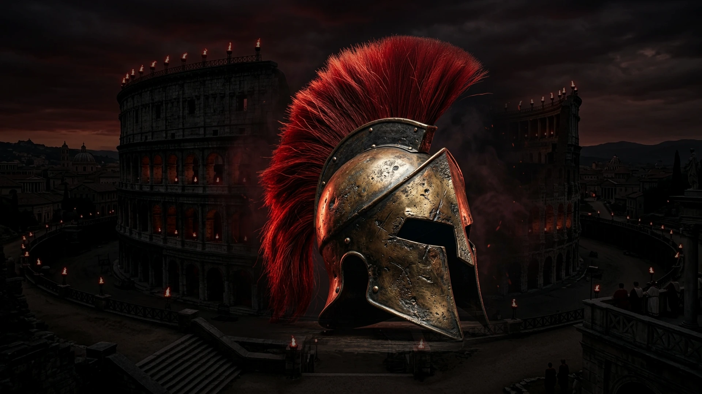

<div align="center">

# ⚔️ ODYSSEY
### *A Cinematic Ancient Roman & Spartan War-Inspired Fitness Experience*

**"YOUR BATTLE. YOUR LEGACY."**

[](https://react.dev/)
[](https://vitejs.dev/)
[](https://tailwindcss.com/)
[](./LICENSE)
[]()

<br />



<br /><br />

> *"Every generation has its arena. Ours is where discipline meets resistance, where limits are challenged, and where strength is earned one repetition at a time."*

</div>

---

## 🏛️ Creative Direction & Brand Identity

**ODYSSEY** is an ancient Roman and Spartan war epic reimagined as a modern high-performance gym and warrior performance club. 

Unlike conventional gym websites, ODYSSEY transforms the digital training space into a cinematic battlefield. Ancient warfare serves as the artistic theme—with monumental stone architecture, battle-worn bronze armor, blood-red crests, smoke, and torches—while remaining grounded as a real, premium fitness facility focused on strength training, progressive overload, metabolic conditioning, and athletic transformation.

### Supporting Taglines
- **"FORGED THROUGH RAGE."**
- **"BUILT FOR WAR. TRAINED FOR LIFE."**
- **"EVERY REP IS A BATTLE."**
- **"ENTER AS YOU ARE. LEAVE AS A WARRIOR."**

---

## 🎨 Visual Design System (Red, White & Black Only)

ODYSSEY strictly adheres to a curated **tri-color visual identity**:

| Color Token | Hex Code | Purpose |
| :--- | :--- | :--- |
| **Obsidian Black** | `#080808` | Primary background & deep arena shadows |
| **Deep Black** | `#111111` | Secondary card backgrounds & elevated containers |
| **Charcoal Black** | `#1A1A1A` | Section borders, dividers & architectural lines |
| **Blood Crimson Red** | `#D10A20` | Primary accent, CTAs, flowing crests, & indicators |
| **Intense Red** | `#FF1E35` | Hover highlights, kinetic glows, & active states |
| **Pure White** | `#FFFFFF` | Monumental serif headlines & impact typography |
| **Soft White** | `#E5E5E5` | Secondary headlines & quotes |
| **Muted Gray** | `#A6A6A6` | Supporting body copy & monospace telemetry |

> **Strict Rule**: Zero bronze, gold, brown, purple, or blue as decorative brand colors.

---

## ⚔️ Key Sections & Architecture

### 01. The Arena Entrance (Hero)
- **Central Visual Focal Point**: Colossal battle-worn ancient Spartan warrior helmet with a soaring, vivid blood-red horsehair crest standing in a nocturnal Roman arena with smoke, torches, and crimson rim lighting.
- **Monumental Typography**: Enormous uppercase condensed Roman serif (`ENTER THE ARENA.`).
- **Dual CTAs**: `[ BEGIN YOUR ODYSSEY ]` and `[ EXPLORE THE ARENA ]`.

### 02. The Ancient Arena
- Asymmetrical architectural manifesto with vertical crimson blade divider paired with wide cinematic Roman amphitheater stone arches.
- *“Built in the spirit of battle.”*

### 03. The Warrior's Code
Four immutable laws etched into stone with translucent Roman numeral watermarks (`I`, `II`, `III`, `IV`):
1. **I. DISCIPLINE** — *"Show up when motivation disappears."*
2. **II. RAGE** — *"Channel your intensity. Control your power."*
3. **III. RESILIENCE** — *"Fall. Rise. Return stronger."*
4. **IV. CONSISTENCY** — *"Greatness is built in the repetitions nobody sees."*

### 04. Choose Your Battle (Training Disciplines)
Wide horizontal split-screen editorial showcase featuring:
- **01 — THE FORGE**: Strength training and progressive overload.
- **02 — WAR MACHINE**: Conditioning, stamina, and work capacity.
- **03 — THE GLADIATOR**: Athletic performance, explosive power, and agility.
- **04 — PRECISION**: 1-on-1 Centurion coaching and bespoke periodization.
- Full interactive curriculum modal with intensity, frequency, and architectural pillars.

### 05. The Armory
Industrial gym photography combined with dark stone textures and metal details:
- Competition-grade barbells & calibrated steel plates to 0.25kg tolerances.
- Monolith heavy-gauge 3x3 power cages.
- 50m indoor tactical sprint turf and ballistic rigs.
- Metabolic conditioning engines (Prowler sleds, Concept2 rowers, air bikes).

### 06. The Training Ritual
A dramatic 3-stage visual progression connected by a crimson line:
- **STAGE I — PREPARE**: *Warm up. Focus. Set your intention.*
- **STAGE II — CONQUER**: *Train with purpose. Challenge your limits.*
- **STAGE III — ASCEND**: *Recover. Adapt. Return stronger.*

### 07. The Legion
Human community and camaraderie section displaying athletes training together with zero ego and 100% mutual respect.
- *“No warrior stands alone.”*

### 08. Claim Your Place (Membership)
Intense enlistment card with stone-textured Colosseum backdrop, crimson spine, and expandable tiers (`LEGION ACCESS`, `WARRIOR COMMAND`, `CENTURION PROTOCOL`).

### 09. Communications & Enlistment
Premium enquiry form with live client-side validation, protocol selection, and dedicated dispatch communications.

---

## 🛠️ Tech Stack

- **Core Framework**: [React 19](https://react.dev/) + [Vite 8](https://vitejs.dev/)
- **Styling**: [Tailwind CSS 4](https://tailwindcss.com/)
- **Typography**: Google Fonts ([Cinzel](https://fonts.google.com/specimen/Cinzel), [Oswald](https://fonts.google.com/specimen/Oswald), [Plus Jakarta Sans](https://fonts.google.com/specimen/Plus+Jakarta+Sans))
- **Icons**: [Lucide React](https://lucide.dev/)
- **Responsive Design**: Full desktop, tablet, and mobile viewport optimization (tested down to 375px)

---

## 🚀 Quickstart & Local Development

### 1. Clone the repository
```bash
git clone https://github.com/Sreenidhi1628/odyssey-gym-website.git
cd odyssey-gym-website
```

### 2. Install dependencies
```bash
npm install
```

### 3. Start development server
```bash
npm run dev
```
Open [http://localhost:5173](http://localhost:5173) in your browser.

### 4. Build for production
```bash
npm run build
```
The optimized production bundle will be generated in `/dist`.

---

## 📁 Project Structure

```text
odyssey-gym-website/
├── public/
│   ├── favicon.svg              # Spartan helmet favicon
│   └── images/                  # High-resolution cinematic & gym assets
│       ├── hero_monumental.webp # Hero Spartan helmet in ancient arena
│       ├── arena_colosseum.webp # Amphitheater background
│       ├── legion_athletes.webp # Community athletes training
│       ├── arena-*.jpg          # Armory hardware photography
│       └── prog-*.jpg           # Training program photography
├── src/
│   ├── components/
│   │   ├── Navbar.jsx           # Command center navigation
│   │   ├── Hero.jsx             # Monumental cinematic hero opening
│   │   ├── AncientArena.jsx     # Section 02: Arena manifesto
│   │   ├── WarriorCode.jsx      # Section 03: Four immutable laws
│   │   ├── Training.jsx         # Section 04: Arsenal of disciplines
│   │   ├── ProgramModal.jsx     # In-depth training modal
│   │   ├── Armory.jsx           # Section 05: Facility & hardware
│   │   ├── TrainingRitual.jsx   # Section 06: 3-stage visual journey
│   │   ├── Legion.jsx           # Section 07: Community & camaraderie
│   │   ├── ClaimYourPlace.jsx   # Section 08: Membership enlistment
│   │   ├── Contact.jsx          # Section 09: Communications form
│   │   ├── Footer.jsx           # The Final Oath footer
│   │   └── SpartanHelmetIcon.jsx# Custom SVG helmet emblem
│   ├── App.jsx                  # Main application orchestrator
│   ├── index.css                # Red/White/Black design tokens
│   └── main.jsx                 # Vite React entrypoint
├── index.html                   # HTML5 template with Cinzel font imports
├── vite.config.js               # Vite build configuration
├── package.json                 # Project dependencies & scripts
└── LICENSE                      # MIT License
```

---

## 📜 License

Distributed under the **MIT License**. See [`LICENSE`](./LICENSE) for more information.

---

<div align="center">
  <sub>ODYSSEY WAR ARENA • ANNO DOMINI MMXXVI • ALL RIGHTS RESERVED</sub>
</div>
